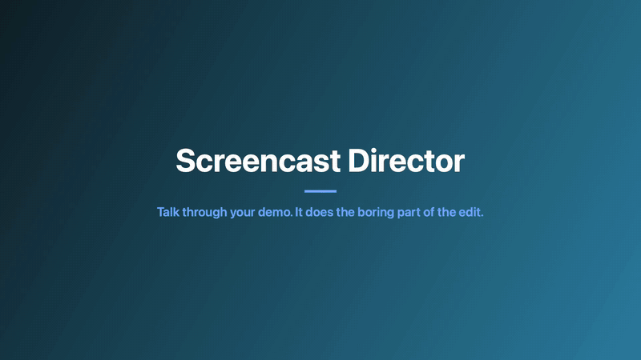
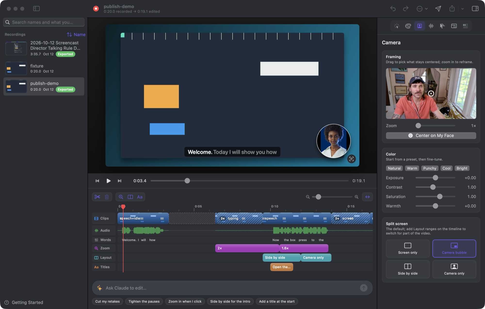

# Screencast Director

[](https://github.com/JoeKarlsson/screencast-director/actions/workflows/test.yml)
[](LICENSE)


A macOS app that records your screen and does the boring part of the edit. Talk
through your demo once: it cuts the dead air, speeds up typing, zooms to your
clicks and captions what you said. Then adjust it by hand, or tell Claude what
to change. This repo has the app and a scriptable CLI (`bin/director`) that
runs the same Swift engine.





## Install

You need a Mac with Apple silicon and macOS 15 or later.

1. Download the latest zip from [GitHub Releases](https://github.com/JoeKarlsson/screencast-director/releases).
2. Unzip it and drag **Screencast Director** to Applications.
3. Open it. The first launch is blocked, because the build isn't notarized by Apple yet. Go to **System Settings > Privacy & Security**, scroll down and click **Open Anyway** (or right-click the app, choose **Open**, then **Open** again). You only do this once.

On first launch, **Getting Started** shows which permissions are missing
(Screen & System Audio Recording, Microphone, Input Monitoring, optionally
Camera) and gives you the command to download a Whisper model. If it says
whisper-cli is missing, run `brew install whisper-cpp`.

AI edits are optional. The Claude box uses [Claude Code](https://claude.com/claude-code)
(your Claude login, no key) if it's installed, or the Anthropic API or any
OpenAI-compatible endpoint with a key you add in Settings. Recording, the draft
edit and exporting all work without it.

## Usage

1. **Record:** press ⌃⌥⌘R in any app, talk through your demo, then press it again.
2. **Draft:** it transcribes on your Mac and drafts the edit. Talking plays in real time, typing without talking plays fast, and silence disappears.
3. **Adjust** on the timeline and inspector (⌘/ lists the shortcuts), or **ask** Claude: "cut my retakes and zoom in when I mention the config." ⌘Z undoes it.
4. **Export:** 16:9, 9:16, square or 4:5, up to 4K, plus captions, chapters, a description draft and thumbnails.

Projects live in `~/Movies/Screencast Director`.

| Doc | What's in it |
| --- | --- |
| [docs/app.md](docs/app.md) | The app in detail: recording, editing, camera, sound, profiles, sharing, AI settings |
| [docs/cli.md](docs/cli.md) | The `director` CLI |
| [docs/plan-format.md](docs/plan-format.md) | The project format both use |
| [docs/privacy.md](docs/privacy.md) | What's recorded and what can leave your Mac |
| [docs/packs.md](docs/packs.md) | Packs: sharing profiles, themes, templates and sounds |

## Profiles and packs

A profile is a saved look: background, fonts, colors, logo, captions, music and
camera settings. A pack is a folder or `.sdpack` zip of profiles plus what they
use (animation themes and templates, logos, Lotties, effects, sounds and music),
so you can hand your look to someone else.

- **Install one someone sent you:** double-click the `.sdpack`, or use **File > Install Pack…**, or run `director pack install <path>`.
- **Share your own:** in the inspector's Profile menu, **Export Profiles as a Pack…**, or `director pack export my-look.sdpack --profile "<name>"`. The app carries the CLI at `/Applications/Screencast Director.app/Contents/MacOS/director`.

Installing a pack never runs anything. See [docs/packs.md](docs/packs.md) for the format.

## Build from source

Apple silicon, macOS 15+, the Xcode Command Line Tools, and whisper.cpp.

```sh
brew install whisper-cpp        # or bundle your own: macos/build-whisper.sh (needs cmake)
git clone https://github.com/JoeKarlsson/screencast-director.git
cd screencast-director
macos/build.sh --install        # builds /Applications/Screencast Director.app
```

A build signed on your own Mac opens without the Open Anyway step.

## Development

```sh
macos/test-all.sh               # lint, unit, playback, media, CLI, animation and GUI smoke tests
macos/test-all.sh --no-smoke    # what CI runs (the smoke test needs a GUI session)
```

Linting needs `brew install swiftlint shellcheck`, and the media tests need
ffmpeg, whisper-cli and a model. Releases: `macos/release.sh` (see
[CONTRIBUTING.md](CONTRIBUTING.md)).

## License

MIT. See [LICENSE](LICENSE).
