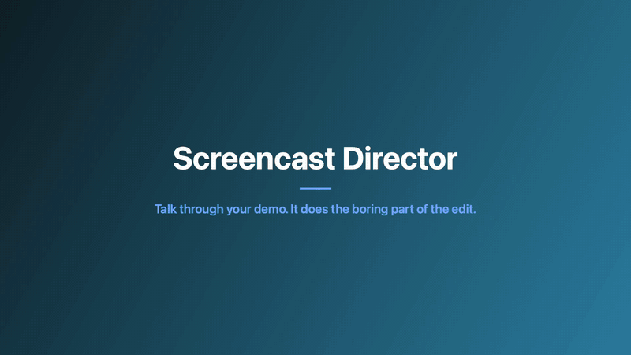
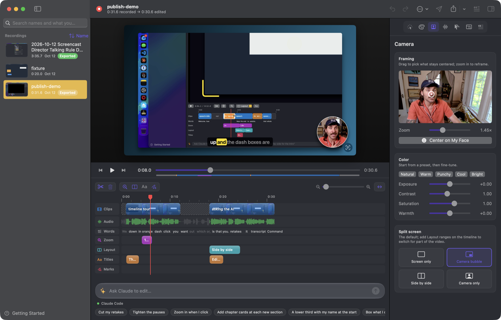

# Screencast Director

[](https://github.com/JoeKarlsson/screencast-director/actions/workflows/test.yml)
[](LICENSE)


[](CONTRIBUTING.md)

A macOS app that records your screen and does the boring part of the edit. Talk through your demo once: it cuts the dead air, speeds up typing, zooms to your clicks and captions what you said. Then adjust it by hand, or tell Claude what to change.





## Install

Apple silicon, macOS 15+, the Xcode Command Line Tools, and `brew install whisper-cpp`.

```sh
macos/build.sh --install      # builds /Applications/Screencast Director.app
```

On first launch, **Getting Started** shows which permissions are missing, gives you the command to download a Whisper model, and plays a short demo.

## Use it

1. **Record:** press ⌃⌥⌘R in any app, talk through your demo, then press it again.
2. **Draft:** it transcribes on your Mac and drafts the edit. Talking plays in real time, typing without talking plays fast, and silence disappears.
3. **Adjust:** use the timeline and inspector. The shortcuts match Screen Studio's, and ⌘/ lists them.
4. **Or ask:** "cut my retakes and zoom in when I mention the config." ⌘Z undoes it.
5. **Export or publish:** 16:9, 9:16, square or 4:5, up to 4K, plus captions, chapters, a description draft and thumbnails.

## Features

- **Timeline:** clips, an audio waveform, words, zooms, layouts and titles.
- **Pauses:** pick Gentle, Normal or Tight, measured from the audio. Changing the level never brings back words you cut.
- **Camera:** bubble, side by side or full frame, auto-centered on your face, with reframing and color grading.
- **Sound:** voice normalizing, volume and a limiter.
- **Profiles:** your look (background, fonts, colors, logo, frame), full bleed or padded.
- **Intro and outro cards** in your profile's fonts, colors and logo.
- **Sharing:** GIFs for docs, and upload to any S3-compatible bucket with the link copied.
- **AI:** Claude Code (your Claude login, no key), the Anthropic API, or any OpenAI-compatible endpoint.
- **Library:** search by name or by what you said, let Claude name recordings, and join takes into one.

Details: [docs/app.md](docs/app.md). The scriptable CLI, which runs the same Swift engine, is in [docs/cli.md](docs/cli.md). Both use the project format in [docs/plan-format.md](docs/plan-format.md).

Privacy: recordings, transcripts and input logs stay on your Mac; see [docs/privacy.md](docs/privacy.md) for what's recorded and what can leave it.

## Contributing and license

See [CONTRIBUTING.md](CONTRIBUTING.md). [MIT](LICENSE).
