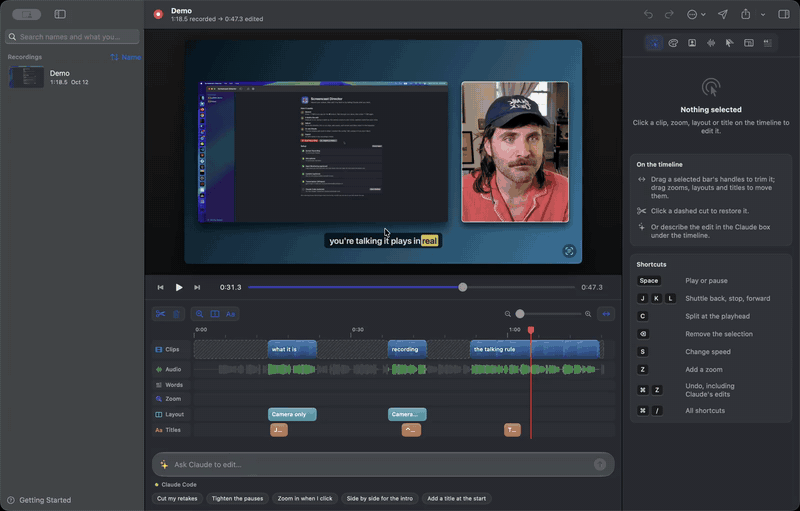
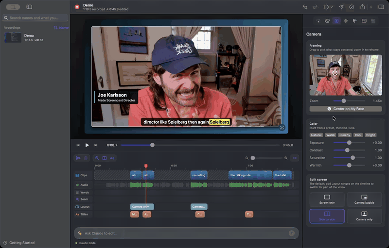
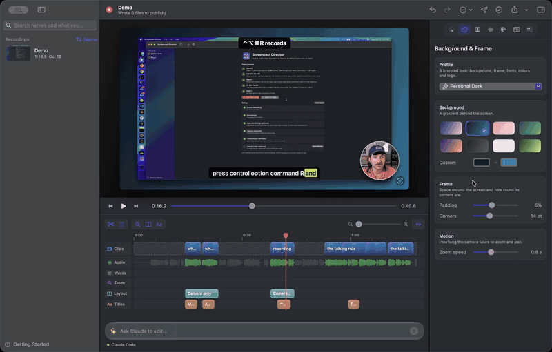
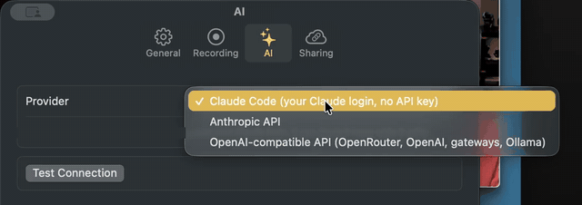
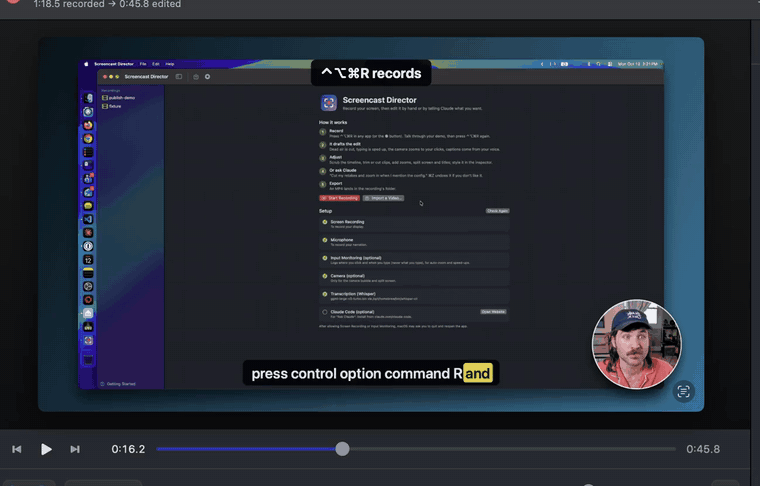

# macOS app

`macos/` is a native app (Apple silicon, macOS 15+) with the same engine as the CLI.

## Install

```sh
brew install whisper-cpp        # or bundle your own: macos/build-whisper.sh (needs cmake)
macos/build.sh --install        # builds /Applications/Screencast Director.app
macos/test.sh                   # Swift checks for the timeline math and planner
```

The app also needs a Whisper model. The Setup window shows the download command, or run:

```sh
curl -L --create-dirs -o ~/Library/Application\ Support/Screencast\ Director/models/ggml-large-v3-turbo.bin \
  https://huggingface.co/ggerganov/whisper.cpp/resolve/main/ggml-large-v3-turbo.bin
```

The app asks for **Screen & System Audio Recording**, **Microphone**, **Input Monitoring** and, optionally, **Camera** permission. Builds are signed with a local code-signing identity when one exists, so permissions survive rebuilds.

Projects live in `~/Movies/Screencast Director`, in the same format the CLI uses.

## Record

Press ⌃⌥⌘R from any app, or use the menu bar button. ScreenCaptureKit records the main display and your mic (the app's own windows stay out of the shot), your camera if you turn it on in Settings, and a click and keystroke log.

When you stop, the app transcribes with whisper.cpp, drafts a plan and opens a live preview.

- **Retakes:** flubbed a line? Press ⌃⌥⌘M (or File > Mark Retake) and say it again. The draft cuts the phrase before the mark, back to the last pause or sentence end (at most 6 s), and keeps the redo. `director describe` lists the marks, and the menu bar flashes RETAKE so you know it took. The hotkeys never show up as shortcut chips.
- **One window:** Settings > Capture records a single window instead of the whole display: crisper text and smaller files. Clicks and the cursor are logged relative to that window, so zooms land in the right place. Window IDs don't survive a relaunch, so the setting goes back to Whole display each time the app starts.
- **FollowSpot scripts:** if FollowSpot is running when you stop, the script it has open is saved as `script.md` in the recording. The draft then keeps only the last take of each script line you read more than once (two halves of one long line both stay), and the AI editor is told to keep the best take of each line.
- **Smooth cursor** (Settings, on by default): the recording leaves out the real pointer, and the video draws one from the mouse log instead, smoothed so hand jitter disappears, scaled with zoom and pulsing on clicks. It fades out after resting 1.5 s and back in when you move it. The Cursor & Overlays tab's **Cursor** section hides it, changes its size and smoothing, or keeps it on screen while it rests (Hide when still, `plan.cursor.idleHide`). Older recordings keep their own cursor.

## Edit



- **Ask the AI** in plain language. The preview reloads when `plan.json` changes.
- **Timeline tracks:** Clips (blue is real time, orange is sped up, dashed is cut; click a cut to restore it) and Audio always show, Words when there's a transcript, and Zoom, Layout, Punch-in, Titles, Marks, B-roll, Animations, Effects and Sound FX once they have something on them. Drag on the ruler to scrub. Select a bar and drag its handles to trim it; drag it to move it.
- **Preview volume:** the speaker and slider under the preview set how loud it plays while you edit (click the speaker to mute). Exports keep the video's own levels.
- **Inspector:** the Selection tab edits the selected item: a clip's speed, a zoom's level and focus (drag on a frame of the recording), a layout's mode, a title's text, and so on. Zooms, punch-ins, layouts, B-roll, animations and effect ranges have a **Label**, which their timeline bar shows and the AI reads. The other tabs are Background & Frame, Camera, Audio, Cursor & Overlays, Format and Transcript. Sections that don't apply to the video fold or hide: the bubble settings fold when no layout shows the bubble, caption settings hide while captions are off.
- **Transcript:** the Transcript tab shows what you said as text. Cut words are struck through, sped-up words are orange. Click a word to jump there; shift-click another to select the run, then press Cut (or ⌫). Select struck-through words and press Restore to put them back.
- **Undo:** ⌘Z undoes any edit, including the AI's.
- **Version history:** every change to `plan.json` (yours, the AI's or another tool's) first saves the previous version to `.history/` in the recording's folder, keeping the newest 30. **… > Version History…** lists them with their length and what differs from now; Restore is undoable.
- **Camera motion:** zooms start moving about 0.3 s before the zoom begins and settle on a longer, softer tail. While the camera pans, the screen is motion blurred in the direction of travel (capped, and only during moves).

## Camera, sound and pauses



- **Camera framing:** new recordings center the camera on your face (Vision face detection across the footage, with enough zoom to pan). In the Camera tab, drag the focus point, change the zoom, or press **Center on My Face**. **Join side by side** (under Split screen, for a padded side-by-side layout) makes the screen and camera one card.
- **Punch-ins:** the viewfinder button on the timeline cuts tighter on the camera over the in/out range, or for 1.5 s from the playhead (`camera.punchIns`). Each one is a bar on the Punch-in row; the inspector sets its scale (below 1× widens, for something held up beside you) and aim.
- **Camera color:** presets in the Camera tab, with **Fine-tune** for exposure, highlights, shadows, contrast, saturation, vibrance and warmth, with Natural, Warm, Punchy, Cool and Bright presets, plus an optional 3D `.cube` LUT (`camera.grade.lut`, copied into the video's `luts/` folder and applied last). `describe` warns when the LUT can't be read.
- **Sound:** **Normalize voice** measures your speaking level and brings it to about -20 dBFS. **Volume** adds up to ±12 dB, and a soft limiter keeps peaks under -0.5 dBFS. **Clean up voice** (`plan.audio.cleanup`) runs the recording's audio once through Apple's voice isolation (the model behind FaceTime's Voice Isolation) plus an 80 Hz high-pass, caches it as `voice-clean.m4a` in the project, and plays that instead, with the same timing. On a 3.6-minute recording it renders in about 3 seconds and takes room noise between words from -63 dB to digital silence while speech stays within 0.4 dB. Delete the file to render it again. Macs without the isolation unit get a high-pass and a gentle expander instead (about 8 dB less noise). The timeline's **Audio** track shows the waveform, with cut ranges dimmed.
- **Music:** **Music Library…** (or **File…** for your own) copies a track into the project and loops it to the video's length (`plan.music`: `file`, `volumeDB`, default -14, and `duckDB`, default -18). While you talk, the music drops by the duck amount over 0.3 s and comes back over 0.6 s; gaps shorter than that stay ducked, so the music doesn't bob between sentences. It fades in over the first second and out over the last two. A profile can carry a default track (`"music": { "file": "theme.m4a" }` in `profile.json`, relative to the profile folder).
- **Sounds on items:** a title or mark can play a sound as it appears, from the project's `sfx/` folder or the sound library (**Library…** in its Sound section), and the sound moves with it.
- **Pauses:** Gentle, Normal or Tight. Silence is measured from the audio, because Whisper's word timings run through short pauses. Word timings are also tightened against the audio when a project loads: each word's start and end move in over silence, never past the word's middle (`transcript.json` keeps Whisper's raw times). Changing the level rewrites only silent cuts, so cuts that removed words stay cut. Settings has the default for new recordings.

## Library

Search the sidebar by name or by anything said in a recording. Right-click a recording to rename it or have the AI suggest a name. With **Name new recordings from what you said** on (the default), new recordings get named after analysis.

**File > Join Recordings…** joins two or more takes (same screen size, oldest first) into a new recording with a fresh draft edit: one `screen.mp4`, a `camera.mp4` when every take has a camera, and the transcript, clicks, loudness and motion shifted onto the joined clock. Videos are copied without re-encoding when possible, and the originals are untouched. No cut or zoom runs across a join (`source.json` lists them in `joins`).

## Profiles and formats



- **Profiles** set a branded look: background, a corner-bracket frame, fonts, caption and title colors, and a logo. With padding at 0 the screen and camera fill the frame (full bleed); turn on **Fill the frame** (`style.fill`) to crop a screen that isn't the frame's shape so no background shows around it, panning to follow zooms and clicks, and the logo, camera bubble, titles and captions all sit at one consistent margin. Pick one per video in the Background & Frame tab, choose a default in Settings, or save any video's look as a profile. The same tab sets the look piece by piece: frame style (plain, brackets or window), accent color, **Logo** (corner, size and opacity), **Titles & chips** (fonts, colors, the camera border, and **Add Font File…**), always-on **Effects**, and the animation theme (paper collage, terminal or zine) under Motion. Profiles live in `~/Library/Application Support/Screencast Director/Profiles/<name>/` with their fonts and logos.
- **Make your own profile:** the app starts with one, Personal. Style a video the way you like and use **Save This Look as a Profile**, or make a folder in Profiles (**Open Profiles Folder** in the inspector's Background & Frame tab) with a `profile.json`. Paths are relative to that folder, and every `look` field is optional:

  ```json
  {
    "name": "My Brand",
    "style": { "background": ["#0f2027", "#2c7da0"], "padding": 0.06, "radius": 14, "transition": 0.8 },
    "look": {
      "fontFiles": ["fonts/Inter-Medium.ttf", "fonts/Inter-Bold.ttf"],
      "captionFont": "Inter-Medium", "titleFont": "Inter-Bold",
      "captionText": "#FFFFFF", "captionHighlight": "#8AB4F8", "captionBackground": "#111111", "captionBackgroundOpacity": 0.9,
      "titleText": "#111111", "titleBackground": "#8AB4F8", "accent": "#8AB4F8", "cameraBorder": "#8AB4F8",
      "frame": "brackets",
      "watermark": { "image": "logo.png", "corner": "bottomRight", "height": 0.03, "opacity": 0.9 }
    }
  }
  ```

  `frame` is `"none"`, `"brackets"` (corner brackets around the screen) or `"window"` (a dark title bar with three dots over the screen card and over a square or rectangular camera, when the layout is padded). `style.joinSide: true` makes side by side one card: the screen and camera touch at the same height instead of sitting apart.

  Fonts are named by their PostScript names. Profiles stay on your Mac: they aren't part of this repo or the app, so a company's fonts and logos never ship with it.
- **Voice, camera and layout defaults:** a profile can also set `audio` (`normalize`, `gainDB`, `warm`, `cleanup`), `camera` (`grade`, with a `lut` relative to the profile folder, and `bubbleSize`, `bubbleShape`, `bubbleBorder`, `bubbleShadow`, `room`, `outline`) and `defaultLayout`. Applying it changes only the fields it sets, and the camera ones only on a video with a camera. **Save This Look as a Profile** always keeps the video's effects and default layout, and asks whether to include its music, voice settings and camera color and bubble.
- **Effects:** shader plugins (film grain, CRT, glitch) that draw on the screen, the camera or the whole frame, under the titles and captions. Add one to the whole video in Background & Frame › Effects, or for a stretch with the wand button on the timeline. A plan or profile lists them in `effects`; see [effects.md](effects.md).
- **Intro and outro cards:** full-frame title cards (about 2.5 s) before and after the video, in the profile's background, title font, accent color, logo and brackets. Switch them on in the Format tab and edit the title, subtitle, length and logo. A profile can switch them on for every video: its `look.intro` / `look.outro` take `enabled` (on unless `false`), `duration`, `title` (`{title}` is the recording's name), `subtitle` and `logo` (default: the watermark), and **Save This Look as a Profile** saves the current video's cards. The video itself starts after the intro, so captions, zooms, SRT and chapters all shift with it. Audio is silent during the cards.
- **Formats:** 16:9, 9:16, 1:1 or 4:5 at 720p to 4K. Vertical, square and feed crop the screen and pan to follow zooms and clicks, with the camera stacked below.
- **Vertical safe area:** TikTok, Instagram Reels and YouTube Shorts lay their own tabs over the top of a vertical video, the caption and buttons over the bottom, and the like and share buttons down the right. In a vertical video every title, chip, caption and the logo stays inside the part they leave uncovered (the top 12%, bottom 22% and right 12% are kept clear), and animations lay out below the top band.
- **Social clips:** mark a range with I and O and press the clip button among the range actions on the timeline. **Format › Clips** names each clip and sets its format (vertical by default), a hook title for its first seconds, how tightly its pauses are cut, and a logo. Export them from the Export menu; each renders from the main edit, so fixes there show up in it.
- **GIF (for docs)** in the Export menu renders the selected clip, zoom or title (or any range you type, in output seconds) as a 720, 640 or 480 px GIF at 12 fps, from the same compositor as the video, and saves it next to the recording.
- **Upload and Copy Link** (grayed out until Settings > Sharing is set up) puts a file from the recording's folder (an export, a GIF, a thumbnail) in an S3-compatible bucket and copies its public link. Set it up in **Settings > Sharing**: endpoint (for example a MinIO server such as `http://192.168.0.202:9000`), region, bucket, access and secret keys (stored in the Keychain), and the public URL the bucket is served from. Uploads are SigV4-signed PUTs, so AWS S3, MinIO, Cloudflare R2 and Backblaze B2 all work. `director upload <file>` does the same with `S3_ENDPOINT`, `S3_BUCKET`, `S3_ACCESS_KEY`, `S3_SECRET_KEY` and optional `S3_REGION` / `S3_PUBLIC_BASE`.
- **Export** renders the current format or any preset (YouTube 4K and 1080p; Shorts, Reels and TikTok; Square; Feed) to its own file without changing the plan. Exports run in the background, one at a time, so you can keep editing: each renders the edit as it was when you queued it. The button next to Export shows the queue, with progress and Cancel.

## AI editing (Settings > AI editing)



- **Claude Code** (default): uses your Claude login, so no API key. After an edit that changes zooms or cuts, it must run `director review`, render a still at the middle of every zoom and just after every cut it changed, look at them, and fix bad framing or mid-word cuts (one fix round) before replying. It also runs `director validate` and fixes what it lists. A follow-up ask continues the same conversation while the recording is open, so "a bit tighter" knows what the last ask did; a new conversation starts after a failed ask or when you reopen the recording.
- With any provider, when an edit leaves a problem in the plan that wasn't there before (a key that isn't a plan field, an overlap, a flash, a missing file), the ask's reply lists it.
- **Anthropic API:** your key, stored in the Keychain.
- **Any OpenAI-compatible endpoint:** OpenRouter, OpenAI, a gateway such as LiteLLM, or Ollama. Fill in the base URL, model and an optional key.

The API providers send the timeline, transcript and plan in one request and get back the whole updated plan. With **Double-check AI edits** on (the default), an edit that changed zooms or cuts gets a second request with what's said and clicked during each zoom and any cut that splits a word, asking for corrections.

## Publish



Exports and GIFs land in `publish/` in the recording's folder, and **Publish…** in the editor writes the rest of what you post beside them:

- `captions.srt`, timed to the edited video
- `chapters.txt`, from your titles (YouTube needs at least three, each at least 10 s long)
- `transcript.txt` with timestamps
- `description.md`: title options, a description, chapters and tags, drafted by your AI provider
- `thumbnail-N.png`: the clearest smiling camera frames, with you cut out of the background next to the screen and the title in your profile's style

## Keyboard shortcuts

They follow Screen Studio's defaults. ⌘/ lists them all.

| Area | Keys |
|---|---|
| Playback | Space plays, J/K/L shuttle, ← → step a frame (⇧ for a second), ⌘← ⌘→ jump to start or end |
| Clips | C splits, ⌫ removes, X removes back to the previous cut, S changes speed |
| Zoom and layout | = and − change zoom level, ⌘D duplicates a zoom, 1-4 set the camera layout, ⌃L adds a layout |
| Timeline and export | ⌘= and ⌘− zoom the timeline, ⌘⇧E exports |
| Additions | Z adds a zoom, T adds a title |

## Headless

`bin/director` (rebuilt when its sources changed) runs `analyze`, `plan`, `describe`, `validate`, `review`, `render`, `still`, `publish`, `pauses`, `frame-camera`, `cut`, `restore`, `profile`, `join`, `gif` and `upload` without the UI:

```sh
director render <project-dir> --preset vertical
director publish <project-dir> --title "My demo"
director pauses <project-dir> tight
director frame-camera <project-dir>
director join <new-dir> <take1> <take2>          # join takes into a new project
director gif <project-dir> --from 10 --to 18     # a GIF of the edited video (output seconds)
director cut <project-dir> 0.94 2.88    # source seconds; restore takes the same arguments
```
